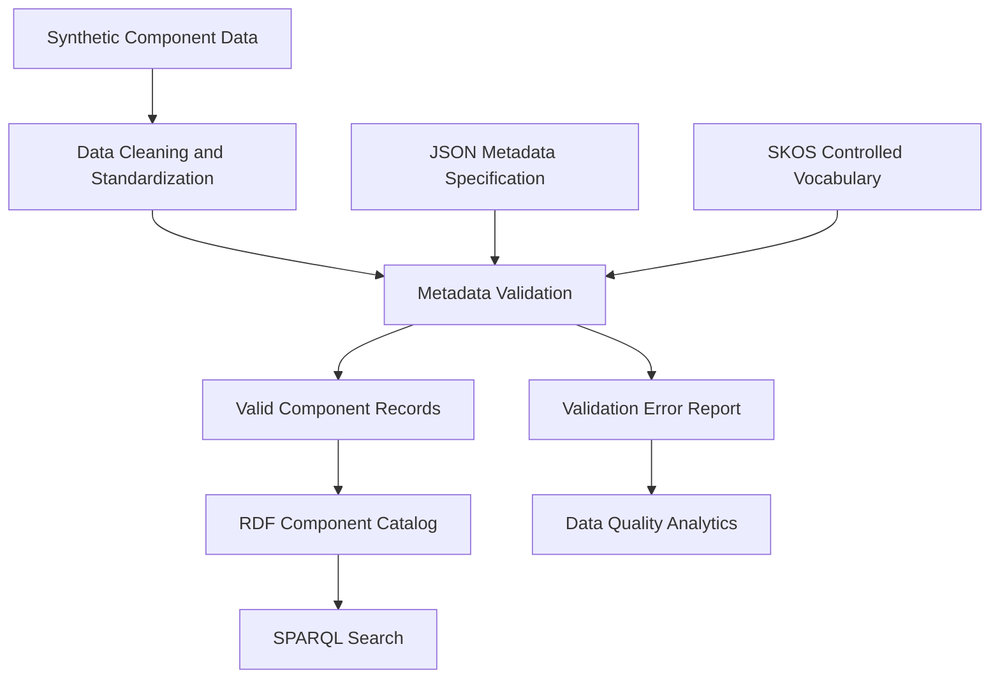
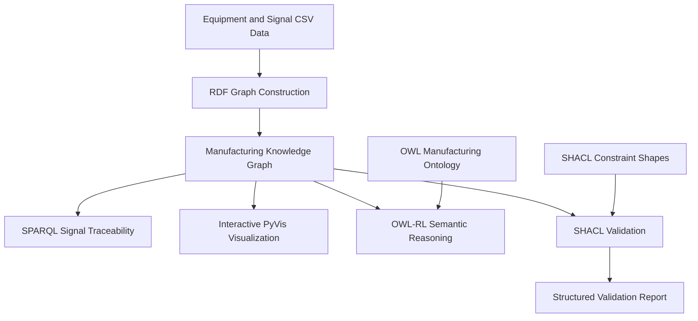
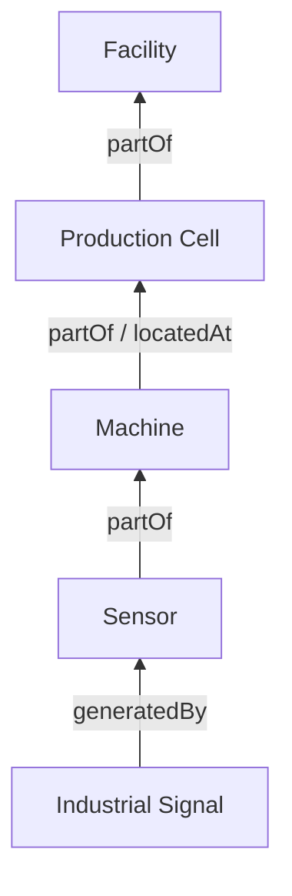

# Maritime Manufacturing Metadata Catalog

A Python-based metadata management system for standardizing, validating, classifying, and retrieving synthetic maritime manufacturing data using semantic web technologies.

The project demonstrates how metadata schemas, controlled vocabularies, ontologies, and knowledge graphs can improve information discovery, data quality, and industrial signal traceability.

**[Explore the Interactive Manufacturing Knowledge Graph](https://jonszuba.github.io/maritime-metadata-catalog/visualizations/equipment_graph.html)**

## Project Highlights

| Metric | Result |
|---|---:|
| Synthetic component records | 1,000 |
| Valid component records | 976 |
| Invalid component records identified | 24 |
| Component validation pass rate | 97.6% |
| Component catalog RDF triples | 4,942 |
| Manufacturing knowledge graph entities | 14 |
| Manufacturing knowledge graph triples | 66 |
| SHACL validation violations | 0 |
| Passing automated tests | 30/30 |

All data is synthetic and does not represent proprietary manufacturing systems.

## Project Overview

The system consists of two complementary metadata models:

- **Component Metadata Catalog:** A reproducible pipeline for cleaning, validating, classifying, and searching maritime manufacturing component records.
- **Manufacturing Knowledge Graph:** An ontology-backed RDF graph connecting facilities, production cells, machines, sensors, and industrial signals.

Together, these models demonstrate metadata management, controlled classification, semantic modeling, automated validation, information retrieval, and industrial data contextualization.

## System Architecture

### Component Metadata Pipeline



### Manufacturing Knowledge Graph



## Technologies

| Technology | Application |
|---|---|
| Python | Data processing, validation, reporting, and retrieval |
| RDF / RDFLib | Semantic graph construction and manipulation |
| Dublin Core | Standardized descriptive metadata |
| SKOS | Controlled vocabularies and hierarchical classification |
| SPARQL | Semantic querying and relationship traversal |
| OWL | Formal ontology modeling |
| Protégé | Ontology development and inspection |
| HermiT | Description logic reasoning |
| OWL-RL | Automated rule-based semantic inference |
| SHACL / PySHACL | RDF graph constraint validation |
| PyVis | Interactive knowledge graph visualization |
| JSON / CSV / Turtle | Metadata definitions, structured datasets, and RDF serialization |
| unittest | Automated integrity and validation testing |
| Git / GitHub | Version control and documentation |

## Key Features

### 1. Metadata Standardization and Validation

Processes 1,000 reproducible synthetic component records through a Python metadata pipeline.

- Standardizes inconsistent metadata values.
- Validates required fields and permitted values.
- Detects duplicate component identifiers.
- Verifies category-subcategory relationships against the SKOS taxonomy.
- Separates valid and invalid records.
- Generates record-level validation reports and aggregated quality metrics.

The component metadata specification is maintained in `metadata/schema.json`.

### 2. SKOS Controlled Vocabulary and RDF Catalog

The component taxonomy contains one concept scheme, four top-level categories, and eight subcategories.

| Category | Subcategories |
|---|---|
| Propulsion | Electric Motors, Propellers |
| Electrical | Batteries, Controllers |
| Structural | Brackets, Hull Panels |
| Navigation | GPS Systems, Sensors |

SKOS preferred labels and broader/narrower relationships establish consistent classification terminology.

Validated component records are represented in an RDF catalog containing 4,942 triples. SPARQL-based search functionality supports retrieval by category, manufacturer, and lifecycle status.

### 3. Manufacturing Equipment Knowledge Graph

The manufacturing graph models a fictional industrial environment containing:

| Entity Type | Count |
|---|---:|
| Facility | 1 |
| Production cells | 2 |
| Machines | 3 |
| Sensors | 4 |
| Industrial signals | 4 |
| Total | 14 |

Custom RDF object properties connect industrial signals to their physical manufacturing context.



The equipment graph is maintained separately from the component catalog in `metadata/equipment_graph.ttl`.

### 4. Industrial Signal Traceability

A SPARQL-based lookup tool retrieves the manufacturing context associated with an operational signal name.

Example search:

`PLC4_TT_1142`

| Metadata Field | Retrieved Value |
|---|---|
| Catalog identifier | SIG-001 |
| Operational signal name | PLC4_TT_1142 |
| Measurement unit | Celsius |
| Sensor | Motor Temperature Sensor |
| Machine | Motor Testing Station |
| Production cell | Propulsion Assembly Cell |
| Facility | Maritime Assembly Facility |

This demonstrates how semantic relationships can make industrial signal metadata more discoverable and interpretable without duplicating the complete equipment hierarchy in each record.

### 5. OWL Ontology and Semantic Reasoning

A formal manufacturing ontology was developed using Protégé.

The ontology defines:

- Six manufacturing classes.
- Three object properties.
- Three datatype properties.
- Property domains and ranges.
- Existential restrictions.
- Class disjointness axioms.

The ontology distinguishes physical manufacturing assets from industrial signals.

```text
owl:Thing
├── PhysicalAsset
│   ├── Facility
│   ├── ProductionCell
│   ├── Machine
│   └── Sensor
└── IndustrialSignal
```

The project uses HermiT in Protégé to evaluate ontology semantics and OWL-RL reasoning in Python to demonstrate automated inference.

Reasoning tests verify superclass membership, domain and range inference, and the distinction between physical assets and industrial signals.

Ontology file: [`metadata/manufacturing_ontology.ttl`](metadata/manufacturing_ontology.ttl)

### 6. SHACL Graph Validation

SHACL constraints enforce explicitly recorded manufacturing metadata requirements.

| Entity | Validation Requirements |
|---|---|
| Physical assets | Exactly one nonempty identifier and label |
| Facility | No parent asset |
| Production cell | Exactly one parent facility |
| Machine | Exactly one parent production cell and matching location |
| Sensor | Exactly one parent machine |
| Industrial signal | Identifier, label, measurement unit, and exactly one generating sensor |

The validation engine produces human-readable results and a structured RDF validation report.

Automated tests deliberately introduce invalid relationships, missing metadata, conflicting locations, and incorrect relationship cardinalities to verify constraint enforcement.

The current manufacturing graph conforms to its SHACL shapes with zero validation violations.

OWL and SHACL serve complementary purposes: OWL defines semantic meaning and supports inference, while SHACL evaluates recorded data against explicit requirements.

### 7. Interactive Knowledge Graph Visualization

The manufacturing graph is rendered as an interactive HTML visualization using PyVis.

Visualization features include:

- Hierarchical manufacturing layout.
- Color-coded entity classifications.
- Labeled and directed relationships.
- Interactive metadata tooltips.
- Entity selection and navigation.
- Zooming and panning.

**[Launch the Interactive Knowledge Graph](https://jonszuba.github.io/maritime-metadata-catalog/visualizations/equipment_graph.html)**

The visualization can also be generated locally using `src/visualize_graph.py`.

### 8. Metadata Quality Analytics

The component validation pipeline identified 24 records containing one or more validation errors.

Detected errors include:

- 20 missing required-field errors.
- 16 invalid taxonomy relationships.

Some records contained multiple errors.

| Category | Total Records | Invalid Records | Failure Rate |
|---|---:|---:|---:|
| Electrical | 248 | 11 | 4.44% |
| Navigation | 254 | 3 | 1.18% |
| Propulsion | 256 | 9 | 3.52% |
| Structural | 242 | 1 | 0.41% |
| Total | 1,000 | 24 | 2.40% |

The overall component validation pass rate is 97.6%.

These metrics reflect deliberately introduced errors in synthetic records, not validation algorithm accuracy or actual manufacturing performance.

## Technical Documentation

The project includes dedicated documentation to support independent maintenance and future development.

| Document | Description |
|---|---|
| [Metadata Design](docs/metadata-design.md) | Metadata architecture, standards, taxonomy, ontology, semantic reasoning, and modeling decisions |
| [Data Dictionary](docs/data-dictionary.md) | Field definitions, identifier conventions, controlled values, RDF mappings, and validation requirements |
| [Maintenance Guide](docs/maintenance-guide.md) | Installation, operation, troubleshooting, testing, and extension procedures |

## Repository Structure

```text
maritime-metadata-catalog/
├── data/
│   ├── raw_components.csv
│   ├── standardized_components.csv
│   ├── valid_components.csv
│   ├── validation_report.csv
│   ├── quality_summary.csv
│   ├── equipment.csv
│   └── signals.csv
├── docs/
│   ├── metadata-design.md
│   ├── data-dictionary.md
│   └── maintenance-guide.md
├── metadata/
│   ├── schema.json
│   ├── taxonomy.ttl
│   ├── catalog.ttl
│   ├── equipment_graph.ttl
│   ├── manufacturing_ontology.ttl
│   ├── manufacturing_shapes.ttl
│   └── shacl_validation_report.ttl
├── src/
│   ├── generate_data.py
│   ├── clean_data.py
│   ├── build_taxonomy.py
│   ├── validation_rules.py
│   ├── quality_control.py
│   ├── build_catalog.py
│   ├── quality_report.py
│   ├── search.py
│   ├── build_equipment_graph.py
│   ├── search_signals.py
│   ├── reason_ontology.py
│   ├── validate_graph.py
│   └── visualize_graph.py
├── tests/
│   ├── test_catalog.py
│   ├── test_validation.py
│   ├── test_equipment.py
│   ├── test_ontology.py
│   ├── test_reasoning.py
│   └── test_shacl.py
├── visualizations/
│   └── equipment_graph.html
├── requirements.txt
└── README.md
```

## Installation and Usage

The project was developed using Python 3.14.

### 1. Clone the Repository

```bash
git clone https://github.com/jonszuba/maritime-metadata-catalog.git
cd maritime-metadata-catalog
```

### 2. Create and Activate a Virtual Environment

```bash
python3 -m venv .venv
source .venv/bin/activate
```

### 3. Install Dependencies

```bash
python -m pip install -r requirements.txt
```

### 4. Generate and Process Component Metadata

```bash
python src/generate_data.py
python src/clean_data.py
python src/build_taxonomy.py
python src/quality_control.py
python src/build_catalog.py
python src/quality_report.py
```

The data generator uses a fixed random seed to produce reproducible results.

### 5. Search the Component Catalog

```bash
python src/search.py
```

### 6. Build and Validate the Manufacturing Knowledge Graph

```bash
python src/build_equipment_graph.py
python src/validate_graph.py
python src/reason_ontology.py
```

### 7. Trace Industrial Signals

```bash
python src/search_signals.py
```

Example input:

```text
PLC4_TT_1142
```

### 8. Generate the Interactive Visualization

```bash
python src/visualize_graph.py
```

Open `visualizations/equipment_graph.html` in a web browser.

### 9. Run Automated Tests

```bash
python -m unittest discover -s tests -v
```

Expected baseline:

```text
Ran 30 tests

OK
```

## Automated Testing

The project includes 30 automated tests covering six areas.

| Test Area | Tests |
|---|---:|
| Component catalog integrity | 5 |
| Component metadata validation | 5 |
| Manufacturing graph integrity | 5 |
| OWL ontology compatibility | 5 |
| Semantic inference | 3 |
| SHACL constraint validation | 7 |
| Total | 30 |

Tests cover both conforming and deliberately invalid metadata to verify expected system behavior.

## Limitations and Future Improvements

The current implementation is a demonstration-scale metadata system rather than a production manufacturing platform.

Potential extensions include:

- Cross-dataset relationships between component records and manufacturing assets.
- Manufacturing identifier uniqueness and format validation.
- Detection of circular equipment relationships.
- Facility reference consistency checks.
- Standardized measurement unit vocabularies.
- Additional metadata provenance, ownership, and governance fields.
- Integration with larger industrial datasets and metadata catalog platforms.

Further implementation considerations are documented in the metadata design and data dictionary.

## Project Purpose

This independent technical portfolio project applies information science principles to manufacturing metadata management, emphasizing controlled vocabularies, semantic interoperability, information retrieval, data quality, ontology development, and maintainable documentation.

All datasets, equipment identifiers, and manufacturing relationships are fictional and were created for demonstration purposes.